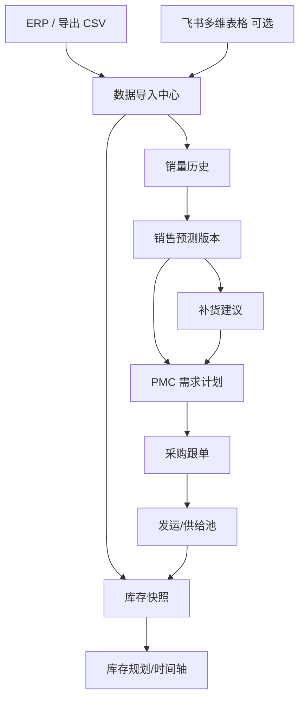

# scm-agent 业务总览（对外版）

跨境电商 **长交期备货** 场景下的供应链计划与执行协同平台：把销量事实、预测、库存头寸、补货建议、PMC 下单与采购跟单串成一条可追溯闭环。系统 **不替代** ERP（如迅捷）做记账与正式 PO，而是作为 **计划层 + 协同层**；主数据与快照可来自 CSV/XLSX 或飞书多维表格同步。

## 1. 解决什么问题

| 痛点 | 系统做法 |
|------|----------|
| 各组预测口径不一致 | 统一销量事实、基线算法、版本发布与准确率复盘 |
| 断货/积压发现晚 | 库存健康灯、horizon 预警、按场景的行动队列 |
| 补货凭经验 | 规则中心参数 + EOQ/ROP/覆盖天数 + 可解释建议行 |
| 跟单信息散在表格与群聊 | 采购跟单台账、定时拉取/推送（可选飞书） |
| 头程费用分摊难 | FOB 分账：体积/拖车/货代三类导入与柜号匹配分摊 |

## 2. 模块地图

| 业务域 | 典型页面 | 核心能力 |
|--------|----------|----------|
| 经营看板 | `/dashboard` | KPI、待办入口 |
| 主数据 | `/data/products` | SPU/SKU、商家、品类 |
| 销量 | `/data/sales` | 历史查询、宽表导入 |
| 预测 | `/data/forecast` | 基线、协作修订、发布（补货主口径） |
| 规划 | `/inventory/planning-dashboard`、`/inventory/alerts` | 健康、断货 horizon、行动队列 |
| 库存 | `/inventory/overview` | 周转/分仓/全链（依赖日快照） |
| 供给 | `/inventory/pools` | 三池批次、未定仓供应（只读） |
| 参数 | `/inventory/safety`、`/system/rules` | 安全库存、规则中心分层参数 |
| PMC | `/pmc/suggestions`、`/pmc/list`、`/pmc/tracking` | 补货建议、需求计划导出、跟单 |
| 合规 | `/compliance/overview` | 完整性看板 |
| 物流 | `/logistics/fob-settlement` | FOB 头程分摊 |
| 智能 | `/ai/chat` | 本地 FAQ + 可选 Dify |
| 系统 | `/system/roles` | RBAC 菜单 |

路由以 `apps/web/src/router.tsx` 为准；发版后可能有增删。

## 3. 核心数据流（简图）

详细字段、表名、算法常量见 [scm-demand-supply-inventory-logic.md](../business/scm-demand-supply-inventory-logic.md)。

## 4. 角色与协作

标准运作见 [scm-sop-operating-standard.md](../business/scm-sop-operating-standard.md) 摘要：

- **运营/销售**：需求情报、促销与渠道变化  
- **需求计划**：预测版本、需求计划发布  
- **供应计划/PMC**：补货建议处理、下单计划、S&OP 主持  
- **采购跟单**：交期、ETA、异常  
- **仓储/库存**：快照核对、数据问题跟进（源数据在 ERP/飞书修正）  

系统强调 **一个共识需求数**、**时界纪律**（冻结/半冻结/自由）、**例外管理**与 **原因码留痕**。

## 5. 与外部系统边界

| 系统 | 关系 |
|------|------|
| ERP（迅捷等） | 销量、库存、PO 事实源；本系统只读同步或文件导入，不在此改 ERP 账 |
| 飞书 | OAuth 登录、多维表格拉取/推送、可选机器人告警 |
| Dify | 可选：对话、预测辅助、预警文案、客服质检评分 |
| 正式财务/PO | 本系统 PMC/跟单为 **计划与协同台账**，非法定采购单 |

## 6. 智能体与工作流（可选）

- **飞书 aily / 自建 Agent**：通过 HTTP 调用本系统 `/api/*`（需登录或内部网关）  
- **Dify**：仓库内 `docs/dify/workflows/` 提供 YAML 示例，导入后配置 API Key  

未部署 AI 时，补货数量与预警类型仍由确定性 TypeScript 规则产生。

## 7. 验收建议（接收方）

1. Docker 部署成功，`/api/health` 正常  
2. 超管登录，RBAC 菜单与角色可配置  
3. 导入一小批脱敏 SKU + 销量 + 库存，跑通预测发布 → 补货建议  
4. 手动触发 `stock-alert` 或等待 cron，确认任务记录  
5. （可选）飞书拉取一条表；Dify 对话一次  

清单可扩展： [docs/qa/](../qa/) 下各模块验收文档（若存在）。
